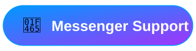

<p align="center">
  
</p>

<h1 align="center">🤖 MR JUWEL — Telegram Bot</h1>

<p align="center"><b>✅ 24/7 Running &nbsp;|&nbsp; ⚡ Prefix & No-Prefix Commands &nbsp;|&nbsp; 📢 বিডি বট টিম (BD Bot Team)</b></p>

---

<h2 align="center">⚙️ কিভাবে কাজ করে</h2>

- 💬 **সবাই ব্যবহার করতে পারবে:** পারমিশন `0` কমান্ড গ্রুপ ও ইনবক্সে সবার জন্য।
- 🛡 **গ্রুপ অ্যাডমিন:** পারমিশন `1` কমান্ড (pin, mute, warn, purge…) শুধু গ্রুপ অ্যাডমিনের।
- 👑 **বট অ্যাডমিন:** পারমিশন `2/3` কমান্ড শুধু `config.json`-এর অ্যাডমিনের। অন্য কেউ দিলে বস-নোটিশ আসে।
- ⌨️ **প্রিফিক্স সহ বা ছাড়া** — দুভাবেই কমান্ড চলে (`/help` বা `help`)।
- ↩️ **রিপ্লাই = মেনশন:** কারো মেসেজে রিপ্লাই করে কমান্ড দিলেই তাকে টার্গেট ধরা হয়।
- 🗣 **বেবি চ্যাট:** "বট", "baby", "জান" লিখলে বট উত্তর দেয় (গ্রুপে বটকে অ্যাডমিন করলে সবার লেখা দেখে)।
- 🦵 **রিঅ্যাক্ট:** বস 🦵 দিলে কিক/লিভ; ❌ 🤬 😡 দিলে মেসেজ আনসেন্ড।
- 🔇 **solo:** `allbot stop` / `allbot on` / `allbot setmaster` — একাধিক বটের মধ্যে একটাকে চালু রাখা।
- 📖 **help:** প্রতি পেজে ১২০টা কমান্ড; পেজ নম্বর রিপ্লাই করলে একই মেসেজ এডিট হয়।
- ♻️ **আপটাইম:** ৬ ঘণ্টার রিস্টার্টেও আপটাইম বজায় থাকে।

---

<h2 align="center">👤 ADMIN INFO</h2>

```text
╔════════════════════════════════════════════╗
║        ✦  A D M I N   P R O F I L E  ✦     ║
╠════════════════════════════════════════════╣
║ ❖ NAME        ➤  乛 MR JUWEL ࿐              ║
║ ❖ BOT NAME    ➤  MR JUWEL BOT               ║
║ ❖ TEAM        ➤  বিডি বট টিম (BD Bot Team)  ║
║ ❖ STYLE       ➤  Sigma Boy • King           ║
╠════════════════════════════════════════════╣
║          Stay Sigma  •  Stay King          ║
╚════════════════════════════════════════════╝
```

<h2 align="center">📞 CONTACT</h2>

<p align="center">
  <a href="https://wa.me/8801943488192?text=Assalamualaikum%20Admin%20Need%20Help%20Please"></a>
  <a href="https://t.me/mrjuwel2025"></a>
  <a href="https://fb.com/mrjuwel777"></a>
</p>
<p align="center">
  <a href="mailto:mrjuwel315@gmail.com"></a>
  <a href="https://www.youtube.com/@BdBotTame"></a>
  <a href="https://m.me/j/bUq30eov7FMa149R/?send_source=gc%3Acopy_invite_link_t"></a>
</p>
